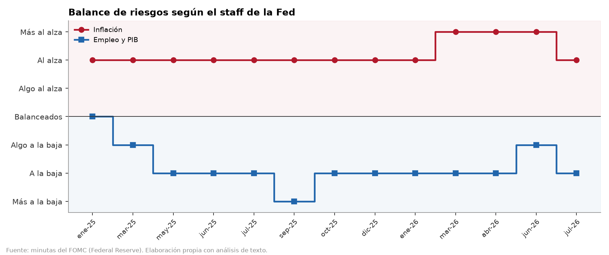
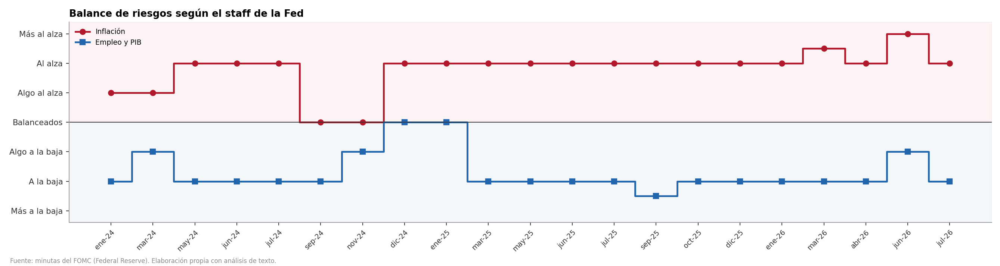

# Comparación de resultados: v1 (antes) vs v2 (después de corregir H1-H3)

*11-oct-2026 · v1 = `salida_fomc_v1/` (recuperada del commit `598ed98`) · v2 = `salida_fomc/` (vigente) · detalle celda por celda en [comparacion_v1_v2.xlsx](comparacion_v1_v2.xlsx)*

## En una frase

En las 13 reuniones que tienen ambas versiones (ene-25 a jul-26) **cambian muy pocos números**, y todos por las correcciones: 4 valores de la escala de riesgos del staff (H3), 4 pesos de cuantificador (H2) y 5 celdas del índice de tono. **No cambian** rango, decisiones, votos, disidentes, datos del staff ni el texto analizado. La diferencia grande es de **alcance**: v2 agrega las 8 reuniones de 2024.

## 1. Alcance

| | v1 (antes) | v2 (después) |
|---|---|---|
| Reuniones | 13 (ene-25 a jul-26) | 21 (ene-24 a jul-26) |
| Cláusulas analizadas | 1,895 | 3,109 |
| Filas en `oraciones` (cláusula × tema) | 2,356 | 3,978 |
| Cómo se corrió | por defecto (`--anio 2025 2026`) | `--solo-local` (todas las minutas en `minutas_html/`) |

Las reuniones de 2024 se dividen en dos grupos:
- **Ene-jun 2024 (4 reuniones):** solo existen en v2. Con el error H1 se leían con 0 párrafos.
- **Jul-dic 2024 (4 reuniones):** ya se leían bien, pero la corrida de v1 no las incluía (por defecto solo toma 2025-26).

Si en algún momento se quiere v2 con exactamente el alcance de v1, basta correr `python fomc_minutas.py --anio 2025 2026`. Restringida a las 13 reuniones comunes, v2 tiene las mismas 1,895 cláusulas y el mismo texto que v1.

## 2. Cambios en las 13 reuniones comunes

### 2.1 Escala de riesgos del staff (H3)

| Reunión | Tema | v1 | v2 | Por qué |
|---|---|---|---|---|
| mar-25 | Empleo y PIB | −0.5 | **−1.0** | "somewhat" calificaba a los datos ("somewhat weaker than expected"), no al riesgo. |
| sep-25 | Empleo y PIB | −1.5 | **−1.25** | "a little more tilted to the downside" ahora vale ±1.25, no ±1.5. |
| mar-26 | Inflación | +1.5 | **+1.25** | "a little more skewed to the upside", mismo caso. |
| abr-26 | Inflación | +1.5 | **+1.0** | "significantly" se refería al nivel de la inflación ("significantly above 2 percent"), no al sesgo del riesgo. |

*v1: el pico de inflación en abr-26 no está en el texto.*

*v2: abr-26 vuelve a "Al alza"; el máximo es jun-26 ("more skewed").*

### 2.2 Pesos de cuantificador (H2)

| Reunión | Cláusula (inicio) | v1 | v2 |
|---|---|---|---|
| oct-25 | "Some participants commented on stretched asset valuations…, with several of these participants…" | some [de a few] = **0.04** | some = **0.25** |
| dic-25 | "although several of these participants noted that weaker demand…" | several [de many] = 0.14 | several [de some] = **0.07** |
| ene-26 | "Some participants commented that it would likely be appropriate to hold the policy rate steady…" | some [de several] = **0.07** | some = **0.25** |
| abr-26 | "Most participants remarked that the developments in the Middle East…" | most [de several] = **0.21** | most = **0.70** |

En dic-25 el padre correcto es el grupo de la misma oración ("Some participants stated… although several of these participants…"), no "many" de la oración anterior.

### 2.3 Índice de tono de los participantes (efecto de H2)

| Reunión | Tema | Suavizado v1 | Suavizado v2 | Diferencia |
|---|---|---|---|---|
| oct-25 | Estabilidad financiera | −0.091 | −0.028 | +0.063 |
| dic-25 | Actividad | +0.474 | +0.491 | +0.017 |
| dic-25 | Inflación | +0.169 | +0.165 | −0.004 |
| ene-26 | Inflación | +0.111 | +0.090 | −0.021 |
| ene-26 | Política monetaria | −0.237 | −0.265 | −0.028 |

Todos los cambios son menores a 0.07 y ninguno cambia el signo ni la lectura del mapa de calor. El mayor, en estabilidad financiera de oct-25, ocurre en una celda con solo 5 cláusulas. Ahí el índice *neto* (sin suavizar) sí se mueve mucho, de −0.80 a −0.17, porque una sola cláusula pesaba casi nada.

### 2.4 Decisiones, votos y posturas

- **Sin cambios:** rango objetivo, votos a favor y en contra, disidentes y su dirección, PCE, desempleo, motores de la narrativa, comunicados y las 6 posturas en las 13 reuniones.
- **Único cambio de "decisión":** ene-25 pasa de "—" a "pausa" (0 pb). No es una corrección de lógica: en v1 era la primera reunión del dataset y no tenía con quién compararse (punto M3 del reporte).

## 3. Lo que agrega v2: las 8 reuniones de 2024

| Reunión | Rango | Decisión | Votos | Disidentes | Riesgo inflación | Riesgo empleo |
|---|---|---|---|---|---|---|
| ene-24 | 5.25–5.50 | — | 12-0 | ninguno | +0.5 | −1.0 |
| mar-24 | 5.25–5.50 | pausa | 12-0 | ninguno | +0.5 | −0.5 |
| may-24 | 5.25–5.50 | pausa | 12-0 | ninguno | +1.0 | −1.0 |
| jun-24 | 5.25–5.50 | pausa | 12-0 | ninguno | +1.0 | −1.0 |
| jul-24 | 5.25–5.50 | pausa | 12-0 | ninguno | +1.0 | −1.0 |
| sep-24 | 4.75–5.00 | recorte −50 pb | 11-1 | Bowman (marcada "recorte"*) | 0.0 | −1.0 |
| nov-24 | 4.50–4.75 | recorte −25 pb | 12-0 | ninguno | 0.0 | −0.5 |
| dic-24 | 4.25–4.50 | recorte −25 pb | 11-1 | Hammack (pausa) | +1.0 | 0.0 |

\* En sep-24 Bowman prefería un recorte **menor** (25 pb en vez de 50). Fue un disenso hawkish, pero el script lo clasifica como "recorte".

**Advertencias sobre 2024**, que no tienen que ver con H1-H3 y ya están en el reporte:
- **PCE total y desempleo:** salen casi vacíos (PCE total solo en dic-24; desempleo solo en ene, mar, may y dic). El staff redactaba esos datos de otra forma y las regex no los reconocen.
- **Balance de posturas:** tiene falsos positivos por negaciones (M1/M5). Por ejemplo, mar-24 marca ≈90 % en "alza condicional" a partir de una frase que habla de bajar tasas, y ene-24 lee "did not expect it would be appropriate to reduce" como recorte probable. **La gráfica `02_balance_posturas.png` de v2 no es confiable para 2024**; la de 2025-26 sí lo es (ver la presentación).

## 4. Otros cambios visibles en v2

- `03_mapa_calor_temas.png`: más espacio entre los dos paneles (con 21 columnas, las fechas tapaban el título del staff). Es solo de formato.
- Todas las gráficas tienen 21 columnas en lugar de 13, así que no se pueden superponer una a una con las de v1.

## Archivos

- `salida_fomc_v1/`: los 13 archivos de la v1, idénticos a los del commit `598ed98`; los CSV conservan sus bytes originales.
- `salida_fomc/`: v2, la vigente.
- `comparacion_v1_v2.xlsx`, con estas hojas: `resumen`, `decisiones_cambios`, `indices_cambios`, `clausulas_cambios`, `posturas_cambios` (vacía), `reuniones_nuevas`, `tono_reuniones_nuevas`.
